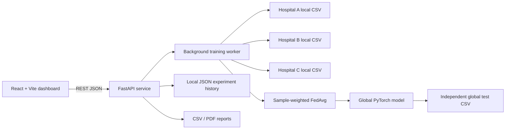

# FedShield

**Secure Intelligence. Distributed Learning. Protected Data.**

FedShield is a local academic demonstration of federated learning with three synthetic hospital clients, a small PyTorch classifier, weighted Federated Averaging (FedAvg), evaluation on an independent test partition, and a React/FastAPI monitoring interface.

> **Important security status:** Local training and ordinary FedAvg work. Flower is pinned as a dependency, and its documented SecAgg+ workflow has been reviewed, but this application does **not** invoke Flower SecAgg+. The aggregator receives each client update in this single-process simulation. The UI and API mark update protection as inactive. Do not treat this project as a production privacy system.

## Problem statement

Organizations may want to learn from data held by different parties without moving their original records into a central dataset. Centralizing those records can increase exposure and governance risk. This project demonstrates the federated-learning workflow, while making clear that local data retention alone does not hide model updates.

## Objectives and proposed solution

- Train a shared model using local synthetic data partitions.
- Keep each generated client CSV in a separate local folder and do not provide raw rows through the API.
- Aggregate model parameters using sample-weighted FedAvg.
- Measure global performance on a separately generated holdout dataset that is never used for training.
- Expose actual experiment metrics, client state, privacy checks, and CSV/PDF reports.
- Explicitly distinguish verified local behavior from unimplemented cryptographic privacy.

## Features

- Dashboard with live service status, training history, model performance, and privacy posture.
- 100,000 synthetic training samples across three organization partitions (Hospital A, Hospital B, Hospital C), plus a separate 20,000-row holdout.
- CPU PyTorch binary classifier with configurable rounds, epochs, batch size, and learning rate.
- Background training thread, stop request, and JSON history.
- Analytics, confusion matrix, privacy-status page, and report exports.
- Responsive dark interface built with React, Vite, Tailwind CSS, Recharts, and Lucide.
- FastAPI validation, bounded configuration, restricted local CORS, and atomic JSON replacement.

## Technology

| Area | Stack |
|---|---|
| Frontend | React 18, Vite 6, Tailwind CSS 3, React Router 7, Recharts 2, Lucide React |
| Backend | Python 3.12, FastAPI, Pydantic, Uvicorn |
| ML | PyTorch, NumPy, Pandas, scikit-learn |
| Federated protocol dependency | Flower 1.20.0 |
| Local storage | CSV and JSON files; no database or SQL |
| Reports | CSV and ReportLab PDF |

All direct dependency versions are pinned in `frontend/package.json` and `requirements.txt`.

## Architecture



In this prototype, the clients are logical partitions invoked inside one Python process. The diagram does not represent isolated hospital machines or a secured network.

## Federated learning workflow

1. On first backend launch, deterministic synthetic partitions totaling 100,000 rows are created under `data/clients/`; a separate 20,000-row holdout is generated under `data/global_test/`.
2. The backend initializes a small binary classifier.
3. Each logical client loads only its own CSV and trains a copy of the current global model.
4. The coordinator receives each local model update and applies sample-weighted FedAvg.
5. The updated global model is evaluated against the test partition and round-level metrics are saved in `storage/training_history.json`.

The test partition is generated with a separate seed and stored separately. It is not loaded by local client training.

## Secure aggregation and privacy limitations

Flower documents a `flwr.server.workflow.SecAggPlusWorkflow` that runs setup, key sharing, masked-vector collection, and unmasking before forwarding aggregated parameters to the strategy. This repository pins Flower, but its REST-driven training service currently runs its own local FedAvg loop and **does not execute that Flower workflow**. Consequently:

- The backend can see individual updates before aggregation.
- “Data stays local” means raw CSV rows are not transmitted through the REST API; it does not mean the backend process is unable to read the local files.
- The client directories are not operating-system or network isolation boundaries.
- There is no differential privacy, secure enclave, or production key management.
- The privacy status endpoints intentionally report individual-update protection and Flower SecAgg+ as inactive.

Before any privacy guarantee is claimed, the training orchestrator must be replaced with a verified Flower deployment that runs the SecAgg+ workflow with separate client processes, a configured threshold/dropout policy, and tests confirming that the server only receives the recovered aggregate. See the [Flower secure-aggregation protocol documentation](https://flower.ai/docs/framework/explanation-ref-secure-aggregation-protocols.html) and [SecAgg+ workflow source](https://github.com/adap/flower/blob/main/framework/py/flwr/server/workflow/secure_aggregation/secaggplus_workflow.py).

## Project structure

```text
backend/
  config.py
  main.py
  federated/
    dataset.py
    model.py
  services/
    training_service.py
  storage/
    json_storage.py
frontend/
  src/
    components/
    pages/
    services/api.js
    App.jsx
    styles.css
  package.json
data/                 # generated synthetic client/test CSVs (git-ignored)
storage/              # generated JSON history/metrics/activity (git-ignored)
tests/
requirements.txt
README.md
```

## Prerequisites

- Windows 10/11
- Python 3.12 (64-bit) and the Python launcher (`py`)
- Node.js 20 or newer with npm
- VS Code (optional)

No paid service, API key, SQL server, Docker, GPU, or external dataset is required. Install dependencies once while online; the application runs locally afterward.

## Windows setup

Open PowerShell in the cloned project folder.

### 1. Clone and prepare Python

```powershell
git clone <your-github-repository-url> FedShield
cd FedShield
py -3.12 -m venv .venv
.\.venv\Scripts\Activate.ps1
python -m pip install --upgrade pip
python -m pip install -r requirements.txt
```

If PowerShell blocks activation, use the venv interpreter directly:

```powershell
.\.venv\Scripts\python.exe -m pip install -r requirements.txt
```

### 2. Install frontend packages

```powershell
cd frontend
npm install
cd ..
```

### 3. Start the backend

From the project root, in a PowerShell terminal:

```powershell
.\.venv\Scripts\python.exe -m uvicorn backend.main:app --host 127.0.0.1 --port 8000
```

The first launch creates 100,000 synthetic training rows split across the clients (33,333 / 33,333 / 33,334) and 20,000 separate test rows. A local dataset manifest tracks the version and sample counts. Existing smaller generated CSVs are automatically replaced once when that manifest is missing or outdated. Previous training metrics are cleared so they are not confused with results from the larger dataset. API docs are available at `http://127.0.0.1:8000/docs`.

### 4. Start the frontend

Open a second PowerShell terminal in the project root:

```powershell
cd frontend
npm run dev
```

Open **http://127.0.0.1:5173**. The backend API is at **http://127.0.0.1:8000**.

### Run a training experiment

Use the **Model training** page, or call the API:

```powershell
Invoke-RestMethod -Method Post `
  -Uri http://127.0.0.1:8000/api/training/start `
  -ContentType "application/json" `
  -Body '{"rounds":5,"local_epochs":1,"learning_rate":0.05,"batch_size":256}'
```

Check progress and results:

```powershell
Invoke-RestMethod http://127.0.0.1:8000/api/training/status
Invoke-RestMethod http://127.0.0.1:8000/api/training/history
```

Download a CSV or PDF report from **Reports**, or open:

```text
http://127.0.0.1:8000/api/reports/export?format=csv
http://127.0.0.1:8000/api/reports/export?format=pdf
```

## API reference

| Method | Endpoint | Purpose |
|---|---|---|
| GET | `/api/health` | Backend readiness |
| GET | `/api/dashboard` | Dashboard metrics, history, activity |
| GET | `/api/clients` | Client status and sample counts (no rows) |
| GET | `/api/clients/{client_id}` | One client's metadata |
| POST | `/api/training/start` | Start validated background training |
| POST | `/api/training/stop` | Request stop after current client |
| GET | `/api/training/status` | Current run status and progress |
| GET | `/api/training/history` | Saved round results |
| GET | `/api/analytics` | Holdout metrics and sample counts |
| GET | `/api/privacy/status` | Verified privacy checklist and limitations |
| GET | `/api/reports/export?format=csv\|pdf` | Download report |

## Dataset and model

`sklearn.datasets.make_classification` generates a deterministic 8-feature binary dataset, stratified into three disjoint local training partitions totaling 100,000 rows (33,333 / 33,333 / 33,334) and a 20,000-sample holdout (20% of training size). A `StandardScaler` is fit only on the combined training partition and applied to the holdout; no test records are used to fit it. These are synthetic data, not patient records. The model is a CPU-friendly PyTorch MLP (`8 → 16 → 1`) trained with binary cross-entropy and SGD. The default local batch size is 256 to keep CPU training practical with the larger dataset.

Metrics include accuracy, precision, recall, F1, binary cross-entropy loss, and a 2×2 confusion matrix. Metric values appear only after a real training/evaluation run; before then the UI shows an empty state.

## Tests

From the repository root with the virtual environment activated:

```powershell
pytest -q
```

The tests cover API health and privacy-status accuracy, JSON replacement, independent data partitions, local PyTorch training, evaluation output, weighted FedAvg, and one complete three-client round. The tests do **not** verify secure aggregation; no such workflow is active in this app.

Frontend production build:

```powershell
cd frontend
npm run build
```

## Screenshots

Add screenshots of the dashboard, training page, privacy center, and reports here after running the application.

## Future work

1. Integrate Flower `SecAggPlusWorkflow` into a real Flower ServerApp/ClientApp execution path rather than this local FedAvg worker.
2. Run client processes independently and verify the aggregation server cannot inspect a single client update.
3. Add explicit protocol threshold and dropout tests before marking any checklist item as protected.
4. Consider differential privacy separately, with documented privacy-budget accounting.
5. Add authenticated deployment, production key management, and hardened storage only if the project moves beyond a local academic demo.

## Contributors

Student project starter. Add contributor names and affiliations here.

## License

No license has been selected. Add a license file before redistributing this project.

## GitHub publishing

Create an empty GitHub repository, then from the project directory:

```powershell
git init
git add .
git commit -m "Build FedShield federated learning demo"
git branch -M main
git remote add origin https://github.com/<your-user>/<your-repository>.git
git push -u origin main
```

Generated datasets, local JSON state, model artifacts, virtual environments, and `.env` files are ignored by `.gitignore`.
